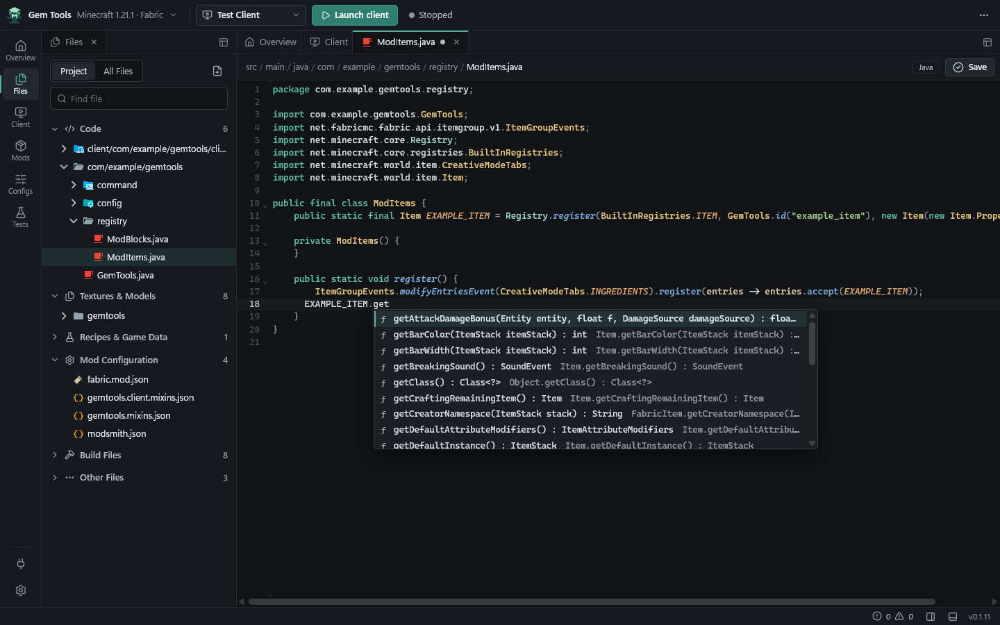

# Modsmith — Minecraft Development Studio

Modsmith is a free desktop application for making Minecraft mods with Fabric, NeoForge and Forge. It creates a mod project from the loader's official template, edits Java and JSON with completion, builds with your project's own Gradle, runs Minecraft inside the same window, and tests your mod against other mods and modpacks.

This Modsmith is a development studio for mod authors. It is not a mod manager for playing modpacks, and it is an independent project that is not affiliated with Mojang Studios or Microsoft.

**[Download](https://github.com/thegalaxydev/modsmith/releases/latest)** · **[Website](https://thegalaxydev.github.io/modsmith/)** · **[Getting started](https://thegalaxydev.github.io/modsmith/docs/getting-started/)** · **[Documentation](https://thegalaxydev.github.io/modsmith/docs/)** · **[Report a problem](https://github.com/thegalaxydev/modsmith/issues)**



## What it does

- **New mod projects** for Fabric, NeoForge and Forge from the official example mods, with optional starter content: an example item, block, command, configuration, data generation, the development bridge and test configurations.
- **Java and JSON editing** with completion, go to definition and Minecraft sources from the Eclipse JDT Language Server, JSON schemas, item and block ID completion, asset checks and a 3D model preview. Find and replace works in a file (Ctrl+F, Ctrl+H) and across the whole project (Ctrl+Shift+F, Ctrl+Shift+H).
- **Project settings** in a form: the mod's name, version, description, authors, license, links and declared dependencies, written to `gradle.properties`, `fabric.mod.json` or `mods.toml` for you.
- **Gradle builds** from the toolbar, with the built mod JAR listed in the Build menu to save a copy or show in its folder, and **isolated test runs** of a client or dedicated server, with the game window embedded in Modsmith on Windows and on Linux with X11.
- **Apply changes** to hot-reload Java method bodies, assets and data packs, and a **Java debugger** with breakpoints, the call stack, variables and expression evaluation.
- **Testing with other mods** from Modrinth, CurseForge, local JARs or whole modpacks, with dependency resolution, hash-verified downloads, locked versions, and update previews with rollback.
- **Testing tools**: an inspector for the running game, scripted test scenarios with a visual editor, multiplayer test sessions, and performance comparisons.
- **Server packs and deploys**: export a server profile as a ready-to-run server, or upload it to your server over SFTP, with a preview of what changes and a BisectHosting preset.
- **An MCP server and a CLI**, so Claude and other MCP clients or scripts can create, build, launch and inspect projects.
- **Extensions** that add file viewers and panels, installed from a reviewed list of Verified extensions or from a link or `.zip`. Each one runs in a sandbox with only the permissions it asks for. An extension can also ship a companion mod that joins development runs and talks to it through the development bridge.

[docs/status.md](docs/status.md) lists how each feature was verified, and what is not implemented yet.

## Supported platforms and loaders

| | Support |
| --- | --- |
| Windows 10 and 11 (64-bit) | Installer (`Modsmith_<version>_x64-setup.exe`) |
| Linux (x86-64) | AppImage and `.deb`. Embedding the game window needs X11 or XWayland; see [Linux](docs/linux.md) |
| macOS | Not available yet |
| Fabric (Loom) | New projects for Minecraft 1.14.4 to 26.3 |
| NeoForge (ModDevGradle) | New projects for Minecraft 1.20.4 to 26.3 |
| Forge (ModDevGradle Legacy) | New projects for Minecraft 1.20.1 |
| ForgeGradle, NeoGradle, Quilt, Architectury | Detected, not supported for building or launching |

Minecraft 1.21.1 (Fabric and NeoForge) and 1.20.1 (Fabric and Forge) are tested by hand with every starter and are the versions with starter content beyond the empty mod and the development bridge. Other versions are generated from the official templates and checked automatically: an empty project builds and its client reaches the title screen. See the [loader and version matrix](docs/loader-matrix.md).

## Install

Download the latest release from the [Releases page](https://github.com/thegalaxydev/modsmith/releases/latest):

- **Windows**: run `Modsmith_<version>_x64-setup.exe`. Modsmith Setup installs for your user account without administrator rights, closes a running Modsmith before updating it, and adds an uninstaller under Settings, Apps. The installer is not code-signed yet, so SmartScreen may ask you to confirm with **More info**, **Run anyway**.
- **Linux**: run the AppImage after `chmod +x`, or install the `.deb` with `sudo apt install ./Modsmith_<version>_amd64.deb`.

Modsmith finds installed JDKs and offers to download Eclipse Temurin when a project needs a Java version you do not have. Fabric projects need JDK 25 for Gradle (Loom 1.18); see [Java](docs/java.md). Modsmith checks for a newer release when it starts and shows a notice with a download link; you can turn this off under Settings, About.

## Create your first mod

1. Open Modsmith and press **New mod**.
2. Choose Fabric, NeoForge or Forge, a Minecraft version and the starter content, then a project name and location.
3. Press **Create project**. The first Gradle build downloads Minecraft and the toolchain, which takes about 1 to 3 minutes.
4. Press **Open and launch client**. Minecraft starts with your mod in the **Client** tab.

The [getting started guide](https://thegalaxydev.github.io/modsmith/docs/getting-started/) covers each step, and [Troubleshooting](https://thegalaxydev.github.io/modsmith/docs/troubleshooting/) covers Java, Gradle and setup problems.

## Documentation

- Website guides: [Getting started](https://thegalaxydev.github.io/modsmith/docs/getting-started/), [Build and test a mod](https://thegalaxydev.github.io/modsmith/docs/build-and-test/), [Test with other mods](https://thegalaxydev.github.io/modsmith/docs/testing-with-other-mods/), [Troubleshooting](https://thegalaxydev.github.io/modsmith/docs/troubleshooting/)
- [Implementation status and limitations](docs/status.md)
- [Supported loader/version matrix](docs/loader-matrix.md)
- [Editor: Java, JSON, assets and debugging](docs/editor.md)
- [Java hot reload](docs/hot-reload.md)
- [Multiplayer test sessions](docs/multiplayer.md)
- [Performance comparisons](docs/performance.md)
- [Project manifest, lock file and scenarios](docs/manifest.md)
- [Java detection and downloads](docs/java.md)
- [Themes](docs/themes.md)
- [Extensions: installing, writing and publishing](docs/extensions.md) and the [Verified extension registry](registry/README.md)
- [MCP setup and tools](docs/mcp.md)
- [Bridge protocol](docs/bridge-protocol.md)
- [Architecture](docs/architecture.md)
- [Linux](docs/linux.md)
- [Releases and update checks](docs/releases.md)
- [Third-party notices](docs/third-party.md)

## Building from source

Requirements:

- Node.js 22+ and npm
- Rust (stable; `x86_64-pc-windows-msvc` on Windows) for the desktop shell and the service
- JDK 21 and JDK 25 to build the bridge mods

```bash
npm install
```

```bash
npm run build:bridge
```

```bash
npm run build
```

`build:bridge` compiles the Java companion mod into `resources/bridge/`. `build` bundles the TypeScript reference service, MCP server, CLI and React UI into `dist/`.

Run the desktop app (Tauri shell; needs WebView2, which Windows 11 includes):

```bash
npm start
```

Build Modsmith Setup, the Windows installer (`target/release/bundle/setup/Modsmith_<version>_x64-setup.exe`):

```bash
npm run setup:build
```

`tauri:prepare`, which `npm start` (an alias of `npm run tauri:dev`) and `tauri:build` run first, builds the renderer, the TypeScript reference bundles and the Rust service (`modsmith-service.exe`, which is also the MCP server and the CLI). The installed app contains no Node runtime. See [docs/architecture.md](docs/architecture.md#desktop-shell).

CLI (starts the background service when needed):

```bash
node bin/modsmith.cjs help
```

```bash
node bin/modsmith.cjs create D:\mods\my-mod --name "My Mod" --starters empty,item,block,bridge,profiles
```

```bash
node bin/modsmith.cjs launch D:\mods\my-mod --profile dev-client
```

MCP configuration for your installation:

```bash
node bin/modsmith.cjs mcp config
```

See [docs/mcp.md](docs/mcp.md).

### Tests

```bash
npm test
```

`npm test` runs the suite twice: once against an in-process `Workbench` (the Node implementation) and once against the Rust service (`target/debug/modsmith-service.exe`, built first), plus the Rust unit tests. `npm run test:node` and `npm run test:rust` run one side. The Rust run includes parity tests that call both implementations on identical fixtures and compare the results, and a fake HTTP server (`test/fakeapi.ts`) stands in for Modrinth, CurseForge and the loader metadata services.

End-to-end smoke test through the MCP server (creates a project, builds, adds Mod Menu from Modrinth, launches Minecraft, uses the bridge, captures a screenshot, stops):

```bash
npm run smoke
```

### Website

The website in [`site/`](site) is plain HTML generated by a dependency-free Node script and deployed to GitHub Pages by [`.github/workflows/site.yml`](.github/workflows/site.yml).

```bash
npm run site:build
```

```bash
npm run site:serve
```

`site:serve` previews it at `http://127.0.0.1:4321/modsmith/`. The production address is set once in `site/site.config.mjs`. See [site/LAUNCH.md](site/LAUNCH.md) for the search engine checklist.

## Contributing

Bug reports and pull requests are welcome in the [issue tracker](https://github.com/thegalaxydev/modsmith/issues). The service exists twice, in Rust (`crates/service`, used by the app) and in TypeScript (`src/core`, the reference implementation), and parity tests keep them identical, so a behavior change goes into both. Run `npm test` before opening a pull request, and update the relevant page in `docs/` when you change what a feature does.

## Support

Ask questions and report problems in [GitHub issues](https://github.com/thegalaxydev/modsmith/issues). Include your Modsmith version (Settings, About), your operating system, the loader and Minecraft version, and the task log from the Tasks panel.

## License

Modsmith is free and will stay free. It is source-available under the [Apache License 2.0 with the Commons Clause](LICENSE) so that nobody can turn it into a commercial product: you may not sell Modsmith, a modified version or fork of it, or a paid product or service whose value comes mainly from Modsmith, such as paid hosting or paid support. Everything else is allowed. You can use it for anything, including making and selling mods and modpacks, and you can modify it and share it for free.

Everything you make with Modsmith is yours with no strings attached: your mods, modpacks and other creations, and every file Modsmith generates into your projects (templates, build scripts, manifests, lock files, exports). See [NOTICE](NOTICE) for that permission and for third-party components.

Minecraft is a trademark of Mojang Synergies AB. Modsmith is not an official Minecraft product.
